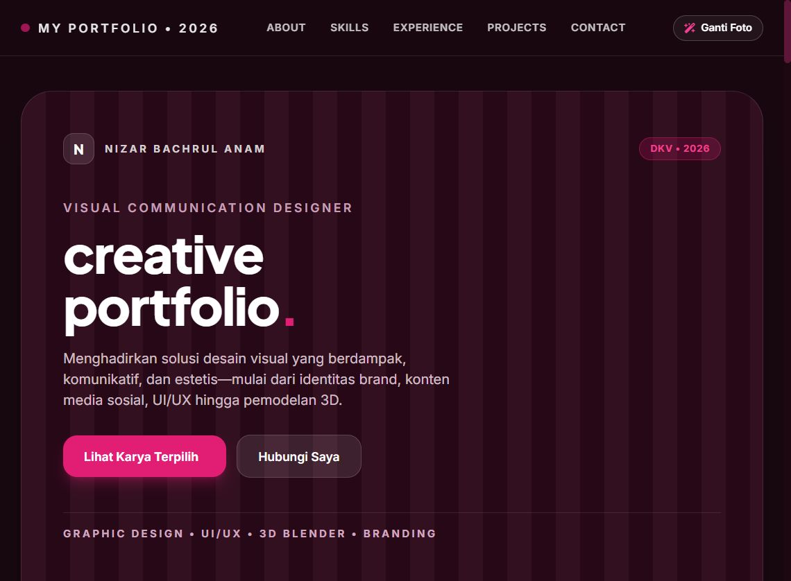

# Creative Portfolio — Nizar Bachrul Anam

Portofolio satu halaman (single-page) untuk **Nizar Bachrul Anam**, Visual Communication Designer. Menampilkan profil, keahlian, pengalaman magang, karya pilihan, serta kontak dalam satu halaman responsif dengan gaya editorial gelap–magenta.

> **Live demo:** `https://<username>.github.io/<nama-repo>/` — ganti bagian ini setelah situs di-deploy.



---

## ✨ Fitur

- **Desain responsif** — nyaman dibaca di mobile, tablet, dan desktop.
- **Filter karya interaktif** — Semua Karya, Magang & Komersial, UI/UX (Figma), 3D Modeling (Blender), Branding & Logo.
- **Modal detail proyek** — setiap kartu karya punya preview berisi deskripsi, tools, galeri, dan poin pengerjaan.
- **Mode "Ganti Foto"** — klik gambar mana pun saat mode edit aktif untuk mengganti foto langsung dari browser (sementara, lihat catatan di bawah).
- **Salin email sekali klik** dan tombol kirim email (`mailto:`).
- **Pesan cepat** — modal formulir kontak dengan notifikasi toast.
- **Animasi halus** — scroll reveal, floating polaroid, dan stempel berputar.
- **Meta tag SEO & Open Graph** — siap dibagikan ke media sosial.

## 🗂️ Section

1. **Hero** — perkenalan, CTA, dan kolase karya.
2. **About** — bio singkat dan polaroid profil.
3. **Skills** — Photoshop, Canva, Figma, Blender 3D.
4. **Experience** — magang di Koota Production + galeri poster & media sosial.
5. **Projects** — karya pilihan dengan filter kategori.
6. **Contact** — email, pesan cepat, dan tautan sosial.

## 🛠️ Teknologi

- HTML5 + CSS3 (custom properties, animasi)
- [Tailwind CSS](https://tailwindcss.com/) via CDN (dengan konfigurasi tema kustom)
- JavaScript vanilla (filter, modal, toast, scroll reveal)
- [Google Fonts](https://fonts.google.com/) — Inter & Plus Jakarta Sans
- [Font Awesome 6.5](https://fontawesome.com/) — ikon

## 📁 Struktur Proyek

```text
.
├── index.html                  # Halaman utama (HTML, CSS, JS inline)
├── assets/
│   ├── favicon.svg
│   ├── foto-profil.jpeg
│   ├── sertifikat-magang.png
│   ├── mockup-kaos.png
│   ├── mockup-jersey.png
│   ├── planton-3d.png
│   ├── karakter-3d.png
│   ├── yakitori-ui.png
│   ├── poster-kuliah-tamu.webp
│   ├── poster-mahasiswa-baru.jpeg
│   └── poster-selamat-datang.webp
├── preview.jpeg                # Tangkapan layar untuk README
├── .nojekyll                   # Agar GitHub Pages tidak memproses lewat Jekyll
└── README.md
```

## 🚀 Menjalankan Secara Lokal

Tidak butuh build tool. Cukup buka `index.html` di browser.

Ingin lewat server lokal (lebih mirip kondisi GitHub Pages):

```bash
# Python 3
python -m http.server 8000

# atau Node.js
npx serve .
```

Lalu buka `http://localhost:8000`.

> Situs memuat Tailwind, Google Fonts, dan Font Awesome dari CDN, jadi butuh koneksi internet.

## 🌐 Deploy ke GitHub Pages

1. Buat repository baru di GitHub (misal `portofolio-nizaranam`).
2. Dari folder proyek, jalankan:

   ```bash
   git init
   git add .
   git commit -m "Initial commit: portfolio Nizar Bachrul Anam"
   git branch -M main
   git remote add origin https://github.com/<username>/<nama-repo>.git
   git push -u origin main
   ```

3. Buka **Settings → Pages** di repository.
4. Pada **Build and deployment**, pilih **Deploy from a branch**.
5. Pilih branch **main** dan folder **/(root)**, lalu **Save**.
6. Tunggu 1–2 menit. Situs tersedia di:

   ```text
   https://<username>.github.io/<nama-repo>/
   ```

> Repository harus **public** untuk GitHub Pages gratis. Jika repo diberi nama `<username>.github.io`, situs dapat diakses langsung di `https://<username>.github.io/`.

## ✏️ Kustomisasi

| Yang ingin diubah | Lokasi |
| --- | --- |
| Nama, bio, dan teks section | `index.html` |
| Data detail proyek (judul, tools, deskripsi, galeri) | objek `projectDetails` di bagian `<script>` |
| Warna tema (plum, magenta, cream) | `tailwind.config` di `<head>` |
| Foto profil & karya | ganti file di folder `assets/` dengan nama yang sama |
| Email | cari `nizar.anam1165@gmail.com` di `index.html` |
| Preview media sosial | tag `og:image` — gunakan URL absolut setelah deploy |

**Mengganti foto permanen:** aktifkan tombol **Ganti Foto** di navbar, klik gambar yang diinginkan, lalu pilih file. Perubahan hanya tersimpan di sesi browser tersebut. Agar permanen, timpa file terkait di folder `assets/` dengan nama file yang sama, lalu commit dan push.

## 📝 Catatan

- Formulir **Pesan Cepat** masih berupa demo UI (belum terhubung ke backend/email). Untuk fungsionalitas nyata, hubungkan ke layanan seperti Formspree, Getform, atau `mailto:`.
- Tailwind CSS dimuat lewat CDN untuk kemudahan. Untuk produksi jangka panjang, disarankan build Tailwind sendiri agar lebih ringan.
- Beberapa gambar berukuran cukup besar (mis. mockup jersey ±2 MB). Kompres ke WebP/JPEG di [Squoosh](https://squoosh.app/) bila ingin loading lebih cepat.

## 📬 Kontak

- **Email:** [nizar.anam1165@gmail.com](mailto:nizar.anam1165@gmail.com)
- **Nama:** Nizar Bachrul Anam — Desain Komunikasi Visual (DKV)

---

© 2026 Nizar Bachrul Anam. Kode boleh dipelajari dan diadaptasi dengan atribusi; foto, karya desain, dan sertifikat tetap milik pemiliknya dan tidak untuk digunakan ulang tanpa izin.
